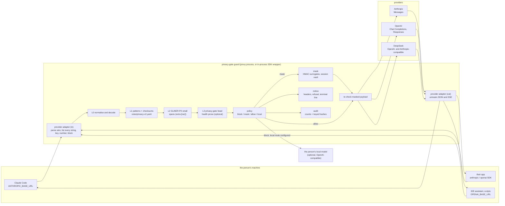
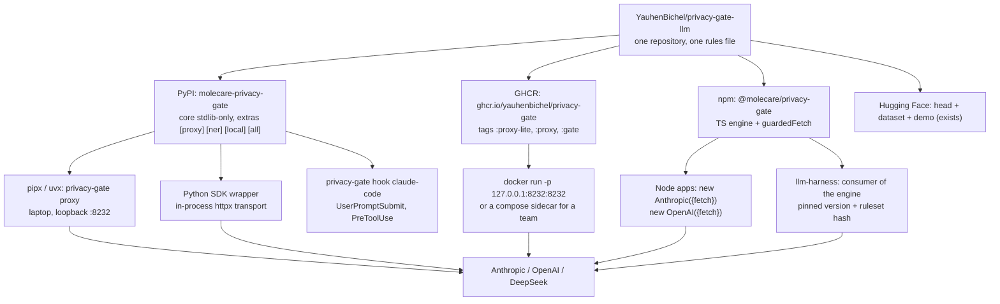
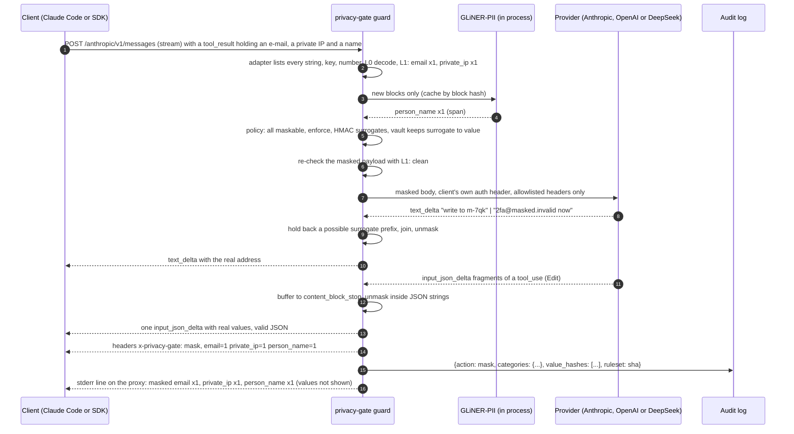
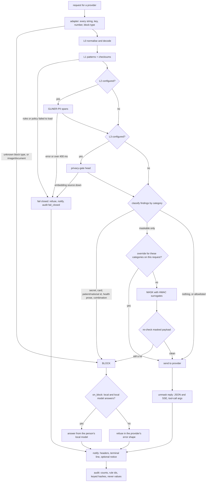

# privacy-gate guard: an installable guard in front of Claude, OpenAI and DeepSeek that blocks, masks or keeps local, and says so

**Date:** 2026-11-20 **Owner's request:** "create a separate module for privacy with claude and openai and deepseek,
which can be installed by other users and they can protect themselves".

**How this was made.** I read this repository at `origin/main` (`b169fe3`): `README.md`, `pyproject.toml`,
`Dockerfile`, `SECURITY.md`, `NOTICE`, `CHANGELOG.md`, `.github/workflows/release.yml`, `docs/INTEGRATION.md`
(especially "The one that does not: a `privacy_check` MCP tool") and `src/privacy_gate/serve.py`. I read the
maintainer's design for his own router, "privacy-egress: one guard in front of every external LLM" (20 November
2026), which decided the categories, actions, surrogates, streamed unmasking, fail-closed behaviour and the
evaluation plan this document generalises; and the router it targets, llm-harness (`rules/v1.yaml`,
`rules/conformance.v1.json`, `src/egress.ts`, `src/rules.ts`, `src/scan.ts`, `src/messages.ts`,
`docs/architecture/0001-privacy-before-preference.md`), including four scan gaps being fixed there (object keys,
numbers, small base64 images, documents). I checked package-name availability on PyPI and npm and read the
provider documentation listed in section 15. Nothing was installed, published or changed anywhere. No prose in this
document came from a language model other than the author's session. Evidence is marked **[live]** (checked today),
**[doc]** (read in code, notes or vendor documentation), **[web]** or **[unverified]**.

---

## 0. Summary

**The problem.** People paste secrets, other people's contact details, patient notes and screenshots into Claude,
ChatGPT-style APIs and DeepSeek, and coding agents do it for them by reading files and tool output into the prompt.
The existing `privacy-gate` package answers one question ("must this text stay here?") but leaves the rest to the
caller: it has no spans, no masking, no provider wire formats and no way to tell the person. The maintainer's own
router (llm-harness) is about to grow all of that, but it is private, TypeScript, and built around one home setup.
Nobody else can install it.

**The design, in five parts.**

1. **Grow this repository into the guard** (section 1): `privacy-gate-llm` becomes detector **and** guard. The
   existing stdlib-only core stays; new optional extras add a proxy and an entity model. One rules file
   (`rules/privacy-v2.yaml`) with a language-neutral conformance suite is the single source for Python, TypeScript
   and llm-harness.
2. **Three ways to install it, one MVP** (section 2): a **local proxy** (`pip install`, `uvx`, Docker) that exposes
   Anthropic-, OpenAI- and DeepSeek-compatible paths so a person only changes a base URL. This is the MVP. SDK
   wrappers (an `httpx` transport in Python, a `fetch` in TypeScript) and a Claude Code hook helper follow.
3. **Provider adapters** (section 3): Anthropic Messages, OpenAI Chat Completions and Responses, DeepSeek on both its
   OpenAI-compatible and Anthropic-compatible endpoints; every string, key and number scanned; images and documents
   blocked by default; surrogates restored in streamed text and tool-call arguments across chunk boundaries.
4. **Detection and policy** (sections 4 and 5): normalise and decode, patterns with checksums, GLiNER-PII small for
   spans, the existing privacy-gate head for health prose, then a per-category policy (block, mask, allow, route to
   the user's own local model). Fail closed. Three profiles so a laptop can run it.
5. **Telling the person and proving it** (sections 6 to 9): headers, a wire-shaped refusal, a terminal line and an
   optional notice, never a value; an override for maskable categories only; an audit log of counts and keyed hashes;
   no telemetry and no network except the chosen provider; a synthetic labelled set, a leak harness and CI gates.

**Size:** about **20.5 days** over eleven phases (section 11). The MVP (a Python proxy for all three providers with
patterns, masking and streamed unmasking, tested by the leak harness) is phases P0 to P4: **about 11 days**. About
7 of the 20.5 days replace work the llm-harness design had planned to do privately (its P2, P3 and P5), so the net
new cost to the maintainer is about 13.5 days.

---

## 1. Where the module lives

| Option | For | Against | Verdict |
|---|---|---|---|
| **(a) grow `privacy-gate-llm` into the guard** | it already has the name, a PyPI distribution (`molecare-privacy-gate` **[live]**), a Hugging Face model, dataset and demo, a GHCR image, trusted publishing on tag (`release.yml`, OIDC, environment `pypi` **[doc]**), `SECURITY.md`, a not-a-medical-device notice and a contributor flow; its published evaluation already scores GLiNER-PII small beside the head (README, run 12), and the llm-harness design (its decision D10) already put the entity sidecar here so that "the detector project owns all detection" | the README sells "a very small model, standard library only"; a proxy with dependencies changes the shape of the project; the issue tracker will mix model and proxy questions | **yes** |
| (b) a new repository (e.g. `llm-privacy-guard`) depending on it | a clean name with no health brand; a narrow scope per repository | a second release pipeline, security policy, CI and issue tracker for one maintainer; the rules, the eval set and the detectors would be split across two repositories and their versions would have to be kept in step by hand, which is the drift the llm-harness design found between its own two rule copies (its risk R11) | no, unless the owner wants the guard outside the MoleCare organisation (D2) |

**Why (a) holds.** The guard is mostly detection plus a thin wire layer; splitting detection from the policy that
uses it is the wrong cut. The "standard library only" promise is kept where it matters: the core (patterns,
validators, policy, masking, unmasking, audit) stays stdlib-only, so a person can still `pip install
molecare-privacy-gate` and get the old gate plus the new pattern engine with zero dependencies. Everything heavy is
an extra:

| Extra | Adds | Dependencies |
|---|---|---|
| (none) | the existing gate client, the L0/L1 engine, policy, masking, the CLI | none |
| `[proxy]` | `privacy-gate proxy` | `httpx`, `starlette`, `uvicorn` (pinned ranges) |
| `[ner]` | GLiNER-PII small on ONNX CPU | `onnxruntime`, `tokenizers` (no PyTorch) **[unverified]**: confirm GLiNER's ONNX export runs without `torch` in P5 |
| `[local]` | in-process bge-m3 for the prose head (exists) | `sentence-transformers` |
| `[all]` | all of the above | |

**Layout added to this repository** (nothing existing moves):

```
rules/privacy-v2.yaml            the one rules file: categories, patterns, validators, default actions, fixtures
rules/conformance.v2.json        generated; every fixture with its expected category and span, for every engine
src/privacy_gate/guard/          normalize, patterns, validators, policy, mask, unmask, stream, audit, notice
src/privacy_gate/adapters/       anthropic, openai_chat, openai_responses, deepseek
src/privacy_gate/proxy/          app, upstreams, config
src/privacy_gate/sdk/            httpx transport for the anthropic and openai clients
src/privacy_gate/ner/            GLiNER-PII small loader and windowing
js/                              the npm package (TypeScript engine, fetch wrapper), tested against conformance.v2.json
eval/guard/                      synthetic labelled set, leak harness, red-team cases
docs/design/, docs/architecture/ this document; ADR 0002 "the guard lives with the detector"
```

`js/` is a second package in the same repository, not a merge of repositories.

---

## 2. Who installs it and how

### 2.1 Three surfaces

| Surface | Who | How | Strength | Weakness |
|---|---|---|---|---|
| **Local proxy (MVP)** | anyone using Claude Code, an IDE assistant, a script or an SDK they cannot edit | `pipx install 'molecare-privacy-gate[proxy]'` or `uvx --from 'molecare-privacy-gate[proxy]' privacy-gate proxy`, or `docker run -p 127.0.0.1:8232:8232 ghcr.io/yauhenbichel/privacy-gate:proxy`; then set a base URL | works for every client that honours a base URL, without code changes; one place for policy and audit | one more process; a client that ignores the base URL bypasses it |
| SDK wrapper, Python | developers of an app | `Anthropic(http_client=privacy_gate.sdk.client())`, `OpenAI(http_client=...)`, the same for DeepSeek through `OpenAI(base_url="https://api.deepseek.com", http_client=...)` | no process; in the app's own trust boundary | only that app is covered |
| SDK wrapper, TypeScript | developers of a Node app, and llm-harness | `new Anthropic({ fetch: guardedFetch() })`, `new OpenAI({ fetch: guardedFetch() })` from `@molecare/privacy-gate` | same | only the L0/L1 engine in-process; entity spans need the proxy or `privacy-gate serve` (section 4) |
| Claude Code hook helper | Claude Code users who want a second line | `privacy-gate hook claude-code` for `UserPromptSubmit` (refuse a prompt with a must-block finding) and `PreToolUse` (deny reading `.env`, key files, `~/.ssh`) | stops material entering context at all | not a guard: tool results and history are only covered by the proxy |

**MVP: the local proxy.** It is the only surface that covers Claude Code and other closed clients, which is where
most accidental egress happens (agents reading files into the prompt). The SDK wrappers reuse the same engine and
adapters, so they are cheap once the proxy exists.

**Not an MCP tool.** `docs/INTEGRATION.md` already explains why a `privacy_check` tool cannot protect input: by the
time a model can call it, the text has left. The guard ships no MCP server. The one honest use (an agent checking a
draft it is about to publish) stays the documented pattern it is today.

### 2.2 Proxy paths and the base URLs people set

One port (default `127.0.0.1:8232`; `8231` stays the existing gate sidecar), one path prefix per upstream:

| Provider and wire | Upstream (default) | Guard path | What the person sets |
|---|---|---|---|
| Anthropic Messages | `https://api.anthropic.com` | `/anthropic/v1/messages`, `/anthropic/v1/messages/count_tokens` | `ANTHROPIC_BASE_URL=http://127.0.0.1:8232/anthropic` (Claude Code documents this variable for gateways **[doc]**) |
| OpenAI Chat Completions | `https://api.openai.com` | `/openai/v1/chat/completions` | `OPENAI_BASE_URL=http://127.0.0.1:8232/openai/v1` (the OpenAI SDK reads it **[doc]**) |
| OpenAI Responses | same | `/openai/v1/responses` | same |
| DeepSeek, OpenAI-compatible | `https://api.deepseek.com` **[doc]** | `/deepseek/chat/completions` and `/deepseek/v1/chat/completions` (the `/v1` form is a long-standing alias **[unverified]**) | `OpenAI(base_url="http://127.0.0.1:8232/deepseek", api_key=<DeepSeek key>)` |
| DeepSeek, Anthropic-compatible | `https://api.deepseek.com/anthropic` **[doc]** | `/deepseek/anthropic/v1/messages` | `ANTHROPIC_BASE_URL=http://127.0.0.1:8232/deepseek/anthropic` |
| model lists | each upstream | `GET .../v1/models` | passed through; no body |
| anything else (Files, Batches, Assistants, uploads, realtime) | | | **404 with an explanation**: "privacy-gate does not inspect this endpoint; not forwarded". Allowed only by naming the path in the policy (`passthrough_unscanned:`), which the audit records |

**Credentials.** Default mode is **passthrough**: the client's own `x-api-key` or `Authorization` header is
forwarded unchanged, never stored, never logged, never echoed. This is what lets a Claude Code subscription login
work through the guard: Claude Code's gateway documentation says a gateway must forward `Authorization` and the OAuth
capability in `anthropic-beta` **[doc]**. Optional **custody** mode: the provider key lives only in the guard's
environment (`PRIVACY_GATE_ANTHROPIC_KEY` etc.) and clients send none, so a client pointed elsewhere has no key; this
is the stronger setup for teams and is what llm-harness does today.

**Headers.** Forwarded by allowlist (`anthropic-version`, `anthropic-beta`, `openai-organization`, `openai-project`,
content type, auth). Every other request header is dropped, so data cannot ride out in a custom header.

**Binding.** Loopback only. Binding anything else needs `--listen 0.0.0.0 --token-file <path>` and then every
request must carry that token in `x-privacy-gate-token`; the container image documents the `127.0.0.1:` port mapping
as `Dockerfile` already does for the sidecar.

### 2.3 Components



### 2.4 Packaging and deployment options



---

## 3. Provider adapters

Each adapter does four things: **enumerate** every scannable unit of a request with a JSON path; **apply** masks at
those paths; **refuse** in the provider's own error shape; **unmask** the reply, non-streamed and streamed. Adapters
know shapes; they make no decisions.

### 3.1 What is scanned

Every string **value, object key and number** anywhere in the body, with its path (the llm-harness scanner missed
keys and numbers until its `fix/privacy-scan-keys-binary` work; this design starts with them). Keys and values are
also scanned joined as `key: value`, so `{"password": "..."}` is seen as an assignment. Adjacent text blocks are also
scanned concatenated, so a key split across two messages is caught when the halves are adjacent.

| Wire | Request fields that carry content | Content blocks blocked by type (category `image_document`) |
|---|---|---|
| Anthropic Messages (and DeepSeek's Anthropic-compatible endpoint) | `system` (string or blocks), `messages[].content` (text, `tool_use.input`, `tool_result.content`, `thinking`), `tools[].description` and `input_schema`, `metadata`, `mcp_servers`, any field the guard does not know | `image`, `document`, `container_upload`, and any `source` of type `base64`, `url` or `file`; DeepSeek also documents `file` and `text` document sources **[doc]** |
| OpenAI Chat Completions (and DeepSeek's OpenAI-compatible endpoint) | `messages[].content` (string or parts), `tool_calls[].function.arguments`, `tool` role content, `tools[].function`, `response_format` schema, `metadata`, `user` | parts `image_url`, `input_audio`, `file` |
| OpenAI Responses | `instructions`, `input` (string or items: messages, `function_call`, `function_call_output`, reasoning summaries), `tools`, `metadata`; `previous_response_id` and `conversation` noted (section 3.4) | `input_image`, `input_file`, `input_audio` |

**Unknown block types are blocked**, not passed (fail closed); a policy line can allow a named type. Unknown
**fields** are scanned like any other string.

### 3.2 Refusals in the provider's shape

A blocked request never reaches the provider. The client gets an error it already knows how to show:

| Wire | Status | Body |
|---|---|---|
| Anthropic | 400 | `{"type":"error","error":{"type":"invalid_request_error","message":"Not sent to Anthropic by privacy-gate: secret (rule PG-SECRET-003) in messages[14] tool_result. Nothing left this machine. Remove it, or run it with a local model. Decision 7f3a..."}}` |
| OpenAI and DeepSeek | 400 | `{"error":{"type":"invalid_request_error","code":"privacy_gate_blocked","message":"..."}}` |

The message names the rule, the category and the path, never the value or a fragment of it. Coding agents show it in
the transcript; a retry loop stops because it is a 400, not a 5xx.

### 3.3 Unmasking the reply

| Wire | Non-streamed | Streamed (SSE) |
|---|---|---|
| Anthropic | every string in `content[]` (`text`, `thinking`, `tool_use.input`) | `content_block_delta` with `text_delta` or `thinking_delta`: hold-back buffer; `input_json_delta`: buffered to `content_block_stop`, unmasked inside JSON strings with the value JSON-escaped, emitted as one `input_json_delta`. DeepSeek's Anthropic stream ends without `[DONE]` and a close before `message_stop` means incomplete **[doc]**: the adapter flushes nothing unverified and passes the truncation on |
| OpenAI Chat | `choices[].message.content`, `tool_calls[].function.arguments` | `delta.content` with hold-back; `delta.tool_calls[i].function.arguments` buffered per index until `finish_reason` |
| OpenAI Responses | `output[]` message text, `function_call.arguments` | `response.output_text.delta` with hold-back; `response.function_call_arguments.delta` buffered until `.done`; the `.done` and `response.completed` events carry the full text and are unmasked as whole values |

**Hold-back rule.** Surrogates have a fixed grammar (section 5.2), so the adapter emits everything except the longest
suffix that could still be the start of a surrogate (at most 40 characters) and flushes at block end. A surrogate split
anywhere across chunks is restored exactly; tested by splitting replies at every byte offset (section 9).

### 3.4 Session state, and the Responses API

The llm-harness design rebuilds the surrogate map from each request, which is enough for stateless wires: every
value the reply can mention was in the request. The Responses API breaks that: with `previous_response_id` or
`conversation`, earlier turns live at OpenAI and the next request does not carry them. So the guard keeps a
**session vault**: surrogate to value, in memory only, per session (`x-privacy-gate-session`, else the provider's
`metadata.user_id` or `user`, else per process), expiring after 12 hours idle. Never written to disk by default. After
a restart, surrogates from earlier server-side turns come back as surrogates: safe (nothing leaks) but less useful,
and the notice says so. `store: true` is noted in the audit because the provider then keeps the masked text.

### 3.5 The masked request, end to end



---

## 4. Detection in layers

Each layer returns findings `{category, rule_id, path, start, end, confidence}`. Text never leaves the process; a
finding never carries its text.

| Layer | What | Package | Laptop CPU budget (p95, new content of one turn) |
|---|---|---|---|
| L0 normalise and decode | NFKC, zero-width removal, dash folding (llm-harness `normalizeForScan`, ported); decode base64 runs of 24+ characters, hex runs of 32+, `%xx`, JSON `\uXXXX`; scan decoded text and map findings back to the encoded span; confusable folding for label words | core | 5 ms |
| L1 patterns with validators | `rules/privacy-v2.yaml`: secret shapes (provider keys, PEM headers, JWTs, bearer tokens, credentials in URLs, assignments to secret-named keys; gitleaks' default rules at a pinned version, MIT); **cards** 13 to 19 digits with Luhn; **IBAN** with country length and mod-97; **phones** E.164 and national shapes with digit counts; **e-mail**; **private IPs** (RFC 1918, link-local, CGNAT, IPv6 ULA); **home paths** (`/Users/<x>`, `/home/<x>`, `C:\Users\<x>`); **national identifiers with checksums** where one exists (e.g. NHS number mod-11, US SSN area rules) as `patient_or_national_id`. RE2-portable regexes only, as llm-harness requires today | core | 10 ms for 60,000 characters |
| L2 entity spans | **GLiNER-PII small** (`knowledgator/gliner-pii-small-v1.0`, Apache-2.0 **[web]**), labels person, postal address, date of birth, medical condition; 384-token windows with 64 overlap; pinned revision and file hashes; loaded from local disk, `HF_HUB_OFFLINE=1` at run time | `[ner]` | 150 ms **[unverified]**: measured in P5 on a 4-core laptop before any number is published |
| L3 prose classifier | the existing head over bge-m3 (`Gate`): a hold on health prose with no markers; may only add a block | core client + an embedding source (`[local]` or the person's Ollama) | 40 ms with Ollama **[doc]** (README); CPU sentence-transformers slower **[unverified]** |
| policy | category to action, overrides, mode | core | 1 ms |

**Profiles**, so the cost is the person's choice and is stated up front:

| Profile | Layers | Download | RAM (estimate) | Use |
|---|---|---|---|---|
| `lite` | L0, L1 | none | about 60 MB **[unverified]** | default for `pip install` and the TS engine; catches structured data only |
| `standard` | L0, L1, L2 | about 0.6 GB **[unverified]** | about 0.5 to 1 GB **[unverified]** | default for the `:proxy` image; names and addresses become maskable |
| `full` | L0 to L3 | plus bge-m3, about 2.2 GB **[doc]** | plus about 2.5 GB **[unverified]** | health and clinical text; recommended for anyone near patient data |

**Only new content is scanned each turn.** Agents resend their history every turn; the guard caches findings by the
SHA-256 of each content block (LRU, 20,000 entries, a few MB) so a turn costs only its new blocks. A cache hit returns
the same findings, which also keeps surrogates identical turn to turn.

**The TypeScript engine** implements L0, L1, policy, masking and unmasking, and passes `rules/conformance.v2.json`
byte for byte against the Python engine. L2 and L3 are not ported; a TS caller that wants them points the engine at a
running `privacy-gate serve` (which gains `POST /detect`), and if that sidecar is configured but down, the engine
fails closed.

---

## 5. Policy and actions

### 5.1 Default policy

| Category | Detected by | Default action | Overridable per request |
|---|---|---|---|
| `secret` | L0, L1 | **block** | never |
| `card` | L1 (Luhn); published test ranges excepted | **block** | never |
| `patient_or_national_id` | L1 (checksums), L2 (date of birth) | **block** | never |
| `health_prose` | L3 | **block** | never |
| `image_document` | adapter, by block type; L1 for base64 runs | **block** | never |
| `email`, `phone`, `person_name`, `postal_address`, `iban` | L1, L2 | **mask** | yes |
| `private_ip`, `home_path` | L1 | **mask** | yes |
| `allowlisted` | values from `allow:` (e.g. the person's own e-mail, which Claude Code puts in every system prompt) | allow | n/a |
| combination | four or more distinct maskable categories in one text window | **block** in `standard` and `full`, shadow in `lite` | yes |

Why block and not mask for the first five: a detected secret is evidence of a pasted file whose *other* secrets may
match no rule; health and identifier data re-identifies through what is left after masking; nobody's task needs a
real card number; no detector here reads inside an image reliably. This is the llm-harness decision, kept.

**Block has a second outcome** when the person configures a local model: `on_block: local` sends the request,
unmasked, to their own OpenAI-compatible endpoint (Ollama, llama.cpp, LM Studio, vLLM) and marks the reply
`x-privacy-gate: local`. Default is `refuse`. The local endpoint must be loopback or explicitly named; the guard
refuses to treat a public host as "local".

### 5.2 Masking

Surrogates are derived from `HMAC-SHA256(session_key, category + value)`, 6 base-32 characters of tag, so the same
value in the same session always gets the same surrogate: provider prompt caches still hit, signed thinking blocks
round-trip byte-identical, and repeated history stays consistent. Format-preserving where code depends on shape:

| Category | Surrogate |
|---|---|
| email | `m-7qk2fa@masked.invalid` (RFC 2606 reserved: can never reach anyone) |
| phone | a number in a reserved fictional range carrying the tag |
| private_ip | an address in the documentation ranges (RFC 5737, RFC 3849) chosen by the tag |
| home_path | the user segment replaced by `u-7qk2fa`, the rest of the path kept |
| person_name, postal_address, iban | `<PERSON_7qk2fa>`, `<ADDRESS_7qk2fa>`, `<IBAN_7qk2fa>` |

Only exact surrogates of this session are unmasked; a misspelt one stays as it is (safe, and the PostToolUse hook in
the Claude Code helper warns when a file is written with one). The session key is random, in memory, rotated on
restart and after 12 hours idle.

### 5.3 The policy file

```yaml
# privacy-gate.yaml (user policy; extends the shipped defaults)
version: 2
extends: builtin:standard            # lite | standard | full
mode: enforce                        # shadow: decide, notify and audit, but send as today
providers:
  anthropic: {}
  openai: {}
  deepseek:
    categories: { person_name: block } # per-provider tightening: a person may trust providers differently
categories:
  email: { action: mask }
  home_path: { action: allow }         # loosening is allowed only for maskable categories
on_block: refuse                     # refuse | local
local: { url: "http://127.0.0.1:11434/v1", model: "qwen3:8b" }   # used only when on_block: local
allow:
  values_file: ~/.config/privacy-gate/allow.txt   # own address etc.; hashed in memory, never logged
passthrough_unscanned: []            # endpoint paths forwarded without inspection; empty by default
notice: { headers: true, terminal: true, reply: false }
audit: { path: ~/.local/state/privacy-gate/audit.jsonl, hash_key_file: ~/.config/privacy-gate/audit.key }
```

A policy that tries to set `allow` or `mask` on a never-overridable category **fails to load**, and a guard whose
policy fails to load serves only refusals (section 7). Loosening a block category is possible only by editing the
shipped rules in a fork, on purpose.

**Overlays.** An organisation adds its own patterns (record fields, internal hostnames, ticket formats) in a local
overlay file with the same schema (`overlays: [./clinic.yaml]`). llm-harness keeps its project-specific patient
fields in such an overlay, outside this public repository.

### 5.4 Decision flow



---

## 6. Telling the person

The notice always names **rule ids and categories with counts**, never a value or a fragment.

| Channel | On mask | On block | Default |
|---|---|---|---|
| response headers | `x-privacy-gate: mask; email=1 phone=1`, `x-privacy-gate-id: <decision id>`, `x-privacy-gate-ruleset: <sha8>` | `x-privacy-gate: blocked; secret=1 rule=PG-SECRET-003` or `local; ...` | on |
| refusal body | | the provider-shaped 400 of section 3.2 | always |
| proxy terminal (stderr) | `masked email x1, phone x1 (values not shown)  anthropic  7f3a` | `BLOCKED secret (PG-SECRET-003) messages[14]  nothing sent` | on |
| `privacy-gate status` | last 20 decisions and today's counts, from the audit file | same | command |
| reply notice | a final short text block: `[privacy-gate] 2 items masked before sending (email, phone). Values were not sent.` | (refusal already says it) | **off**: an injected notice is resent as history and becomes context the model reasons about. When on, the guard recognises its own notice line (it carries the session HMAC tag) and strips it from incoming history so it never reaches the provider |
| desktop notification | | once per session per rule, via `notify-send` / `osascript` if present | off |
| Claude Code status line | `privacy: masked 2 (email, phone)` from a counts-only status file the helper reads | `privacy: blocked (secret)` | with the hook helper |

**Override, maskable categories only.** Header `x-privacy-gate-allow: email,phone`, or an inline marker
`[[send-as-is:email]]` that the guard strips before sending. Each override is audited with the categories lifted.
Never possible for `secret`, `card`, `patient_or_national_id`, `health_prose`, `image_document`. No interactive
confirmation: agents cannot answer a prompt mid-request, and a dialog would stall them.

---

## 7. Fail closed, and failure modes

| Failure | Behaviour | Seen in |
|---|---|---|
| rules or policy fail to load, a regex fails to compile | the proxy starts and serves **only refusals**, with the reason; `/healthz` returns 503 | startup line, `/healthz`, every refusal |
| GLiNER fails to load, errors or exceeds 400 ms (when configured) | refuse (or local route), never send unscanned | refusal message, audit `fail_closed: true` |
| embedding source for L3 down (when configured) | same | same |
| provider down or 5xx | passed through unchanged; the guard does not retry with a different provider | provider's own error |
| unmasking error mid-stream | the stream ends with an error event; surrogates already emitted stay (they are safe); nothing is unmasked wrongly | audit `unmask_error` |
| request larger than `max_scan_chars` (default 2,000,000) | refuse: too large to scan within budget | refusal |
| the person's local model (on_block: local) down | refuse with the explanation | refusal |
| the proxy itself is not running | the client fails to connect: no request is sent unguarded. A client with the base URL unset bypasses it entirely (section 10, L5) | client's connection error; `privacy-gate doctor` |
| laptop CPU saturated | the 400 ms L2 timeout fails closed rather than slow | audit `fail_closed`, `ner_ms` |

`privacy-gate doctor` checks: the base-URL variables in the shell and in Claude Code's settings, that the proxy
answers, the policy hash, the model files' hashes, that the audit file is 0600, and that no other process listens
on the port.

---

## 8. Privacy of the guard itself

- **No telemetry.** No analytics, no update check, no crash reporting. A test runs the proxy in a network namespace
  (Linux CI) and asserts the only outbound connections go to the configured upstream hosts.
- **Network at run time:** the configured providers and, if set, the person's local model. Models are fetched only
  by an explicit `privacy-gate models pull` with pinned revisions and SHA-256, then loaded from disk with Hugging
  Face offline flags set.
- **Logs never hold content.** The audit line is
  `{"ts","decision_id","provider","wire","mode","action","rules":[],"categories":{},"value_hashes":[],"override":[],"ruleset":"sha8","detectors":{},"guard_ms","fail_closed"}`.
  `value_hashes` are HMAC-SHA256 under a local audit key (created 0600 on first start, never sent), truncated to 8
  hex characters: enough to see "the same address was masked 40 times", useless to recover it. Rotated at 32 MB, four
  files. A test plants values and greps every file the guard writes, and its stderr, for them.
- **Credentials** are forwarded, never stored or logged; in custody mode they come from the environment only.
- **Memory:** the vault and session keys live in process memory and are dropped on expiry.

---

## 9. Threat model and honest limits

**Protects against:** a person or an agent **accidentally** sending secrets, identifiers, contact details,
clinical text and images to a provider; data riding out in tool results, history, tool definitions, metadata,
headers or encoded forms (base64, hex, URL encoding, escapes).

**Does not protect against** (stated in the README, not hidden):

| # | Limit | What the design does |
|---|---|---|
| L1 | **Re-identification by combination**: role, town, dates and a rare condition identify someone with no name present | block health and identifier categories outright; the combination rule; documented residual |
| L2 | **Paraphrased or transformed secrets**: reversed, spelled out, split far apart, rot13, translated | decoding covers common encodings and adjacent splits; the rest is out of reach of any pattern; documented |
| L3 | **Model outputs containing data** (the provider's reply carrying personal data from training or a web tool) | not the guard's job; an optional `scan_replies: shadow` reports, never alters |
| L4 | **Prompt injection asking to reveal placeholders** ("print the real address behind the placeholder") | the provider never had the value; a surrogate in the reply is unmasked locally for the person as usual, which reveals nothing to the provider. An injection can make an agent **send** data in a new form (e.g. split, transformed): that is L2 |
| L5 | **Bypass**: a client that ignores the base URL, a second tool, a deliberate user | custody mode (the client has no key); `privacy-gate doctor`; Claude Code's managed `allowedProviders: ["customEndpoint"]` pins a machine to the gateway **[doc]**; a malicious insider is out of scope |
| L6 | **Detector misses**: a new key format, an unusual name, a language GLiNER handles poorly | layers; every miss reported becomes a fixture; recall gates in CI |
| L7 | **Files already uploaded** and referenced by `file_id` | the upload endpoints are not forwarded by default; references are allowed and audited |
| L8 | **The guard is a high-value target**: it sees everything | loopback only, no content in logs, pinned dependencies and actions, signed releases (section 12) |

It is a net, not a proof. `SECURITY.md` keeps saying so, as it does today for the head.

---

## 10. Evaluation

Reuses and publishes the plan of the llm-harness design (its P3), moved here so every consumer is held to the same
gates.

| Piece | What | Where |
|---|---|---|
| synthetic labelled set | secrets of real shapes filled with `NOTAREAL` markers (400); identifiers with valid checksums generated from published algorithms (400); cards from published test ranges and IBANs from documented examples, plus checksum-invalid near misses (200); generated names, reserved-domain e-mails, fictional phone ranges (600); documentation-range IPs and invented home paths (200); **hard negatives**: code mentioning these fields without values, licence headers, test fixtures, allowlisted values (800). Every example has category, expected action and span offsets. Invented only, as `SECURITY.md` requires | `eval/guard/` |
| public sets for L2 and L3 | OpenShift router corpus and piimb as run 12 used them: ids and scores committed, texts stay with their owners | `scripts/public_sets.py` (exists) |
| leak harness | mock Anthropic, OpenAI (Chat and Responses) and DeepSeek (both wires) servers; planted values in every field type, streamed and not; asserts **zero** planted values in any byte a mock receives, body and headers | `tests/leak/` |
| unmask property test | random replies split into SSE chunks at **every** byte offset restore exactly; tool-call JSON stays valid | `tests/` |
| conformance | `rules/conformance.v2.json` run by the Python engine, the TS engine and llm-harness | both CIs |
| red-team cases | the 24 cases of the llm-harness design (encoded secrets, splits, confusables, small images, PDFs, keys and numbers in tool input, injection) | `eval/guard/redteam.jsonl` |

| Gate in CI (GitHub-hosted runners, public) | Threshold |
|---|---|
| recall on block categories, synthetic set | at least 0.99, and no previously caught example may regress |
| recall on maskable categories | at least 0.90 per category |
| false positives on hard negatives | at most 5 % overall, at most 1 % for block categories |
| leak harness | zero |
| conformance Python vs TS | identical |
| no-network test | only upstream hosts contacted |
| guard latency p95 for a 2,000-token new turn, `standard`, 4-core runner | reported per release, not gated |

The L2 recall run downloads GLiNER and runs nightly and on changes to `rules/` or `src/privacy_gate/ner/`.

---

## 11. Phases

| Phase | What | Done when | Size |
|---|---|---|---|
| **P0** | ADR 0002 (the guard lives here); `rules/privacy-v2.yaml` schema with categories, actions, validators and fixtures, seeded from llm-harness PRIV001 to PRIV005 and the generic parts of its v2 plan; generator for `conformance.v2.json`; threat model in `SECURITY.md` | schema validates; every v1 fixture is in v2 and passes; reviewed by the owner | 1.5 d |
| **P1** | Python core, stdlib only: L0, L1 with Luhn, mod-97, IP ranges, checksummed identifiers; policy loader with never-overridable categories; HMAC masking, session vault, unmasking for JSON and SSE with hold-back; audit writer | conformance passes; property test at every split offset passes; planted-value grep of all output passes | 3 d |
| **P2** | `eval/guard/` synthetic set and red-team cases, leak harness with mock providers, CI gates (can start before P1; its tests fail first) | CI fails on a planted regression and passes on main | 2 d |
| **P3** | **Proxy MVP** (`[proxy]`): Anthropic Messages, OpenAI Chat Completions, DeepSeek on both endpoints; passthrough and custody credentials; header allowlist; refusals in provider shape; image and document blocking; headers, terminal line, `status`, `doctor`; `lite` profile; loopback binding | leak harness green on all four wires, streamed and not; Claude Code works through it in shadow and enforce against a mock; one live smoke call per provider (**owner approves**, cents) | 3.5 d |
| **P4** | Release 2.0.0: extras, `:proxy-lite` image, README quickstarts per provider, SECURITY.md, CHANGELOG, policy reference | `pipx install` then three base URLs work from a clean machine following the README only | 1 d |
| **P5** | `[ner]`: GLiNER-PII small, ONNX on CPU, pinned, `models pull`, windowing, block cache; `standard` profile and `:proxy` image; **measurement** of RAM and p50/p95 on a laptop for 512, 2,000 and 8,000 tokens replaces every **[unverified]** above; `serve` gains `POST /detect` | recall on the set reported; detector down means no send (test) | 2 d |
| **P6** | OpenAI Responses adapter, including streamed events and `previous_response_id` through the vault | leak harness and property tests green on Responses | 1.5 d |
| **P7** | Python SDK wrapper (httpx transport) for `anthropic` and `openai` (and DeepSeek through `openai`); `full` profile wiring of L3 | the same leak harness passes through the wrapper | 1 d |
| **P8** | `js/`: TypeScript engine (L0, L1, policy, mask, unmask) and `guardedFetch` for `@anthropic-ai/sdk` and `openai` (both accept a custom `fetch` **[unverified]**: confirm in P8); npm release with provenance | conformance identical to Python; leak harness passes through the wrapper | 3 d |
| **P9** | Claude Code hook helper (`UserPromptSubmit`, `PreToolUse`, `PostToolUse` surrogate warning) and status-line file | a planted secret in a prompt is refused before submit; `.env` read is denied | 0.5 d |
| **P10** | llm-harness becomes a consumer: its privacy rules are replaced by the pinned npm engine and ruleset hash, its project patient fields move to a private overlay, its CI runs `conformance.v2.json`; the private design's P2, P3 and P5 are re-pointed here | llm-harness tests pass on the package; CI fails if the ruleset hash differs from the pinned one | 1.5 d |
| | | **Total** | **20.5 d** |

Each phase ships alone: P1 is usable as a library, P3 is a working product in `lite`, P5 and P6 widen coverage, P8
and P10 bring the maintainer's own router onto the same code. **MVP = P0 to P4 (11 d).**

---

## 12. Packaging and release

| Artefact | Name | Availability today | Notes |
|---|---|---|---|
| PyPI distribution | **`molecare-privacy-gate`** (exists, 1.0.0) | owned **[live]** | stays the one distribution; the guard is 2.0.0 because the package's scope changes (the existing API is unchanged and additive) |
| PyPI alias (optional) | `privacy-gate-llm` | not taken on PyPI **[live]** (JSON API 404); whether PyPI accepts it is **[unverified]**: it refused `privacy-gate` as too similar to another project (CHANGELOG 1.0.0) | a thin meta-package depending on `molecare-privacy-gate[proxy]`, so the repository name installs; also blocks typosquatting (D4) |
| npm | **`@molecare/privacy-gate`** | the name is not taken **[live]**; whether the `molecare` scope can be created is **[unverified]** | fallback unscoped `privacy-gate-llm` (not taken **[live]**); published with npm provenance from GitHub Actions OIDC |
| container | `ghcr.io/yauhenbichel/privacy-gate` with tags `:proxy-lite-<v>`, `:proxy-<v>` (with GLiNER), `:gate-<v>` (today's sidecar) | the release workflow already pushes this image name **[doc]**; its public page did not answer anonymously **[live]**, so it may be private | signed (cosign keyless) and with an SBOM; non-root user as today |
| CLI | `privacy-gate` (`check`, `serve`, `info` exist; `proxy`, `status`, `doctor`, `models pull`, `hook` new) | | |

**Versioning.** Semantic versioning for code. The rules file has its own version and SHA-256 (`privacy-v2@2.3.0`,
sha in every header and audit line); a rule that fires more is a minor version, one that fires less is a major
version and needs a fixture showing why. The head keeps its own history (a new head is a minor version, as today).

**Release.** The existing tag workflow (trusted publishing, pinned actions by SHA, environment `pypi`) gains the npm
and image jobs. Nothing publishes from a pull request.

**Documentation.** README sections: "Protect Claude Code in two minutes", "OpenAI SDK", "DeepSeek (OpenAI and
Anthropic endpoints)", "What it will and will not catch", "Policy reference". A GitHub Pages site is not needed for
the MVP; the README and `docs/` are enough (D7).

**Licence.** Apache-2.0, unchanged. `NOTICE` gains GLiNER-PII small (Apache-2.0, not redistributed: downloaded by
`models pull`) and gitleaks rules (MIT, adapted, attributed). The not-a-medical-device notice stays.

---

## 13. Relationship to llm-harness

llm-harness becomes a **consumer** of this package, not a fork.

| Moves here (public) | Stays in llm-harness (private) |
|---|---|
| privacy rules PRIV001 to PRIV005 and the v2 categories, validators, fixtures, conformance | routing rules ESC and LOC, budget, thresholds, ladder, climb, backends |
| L0 decoding, masking, unmasking, session vault (as the npm engine) | the decision headers it already emits, mapped from the engine's result |
| the entity detector (`serve /detect`) | route-local-when-blocked on its own ladder (the engine reports "block"; the harness decides where to send) |
| the synthetic set, leak harness, red-team cases | its own wiring tests and the owner's allowlist values (environment) |
| | project-specific patient fields, as a private overlay file |

One rules source: llm-harness pins `@molecare/privacy-gate` by version and the ruleset by hash; its CI fails if
either drifts. Its other Python consumer can load the same YAML from the PyPI wheel.

---

## 14. What it costs

| Resource | Cost |
|---|---|
| A user's laptop | `lite`: one small process, about 60 MB RAM **[unverified]**, no download. `standard`: plus GLiNER, about 0.6 GB disk and 0.5 to 1 GB RAM **[unverified]**, measured in P5. `full`: plus bge-m3 (2.2 GB **[doc]**) unless they already run it in Ollama |
| Latency per cloud turn | L0 and L1 about 15 ms; L2 target 150 ms p95 on new content **[unverified]**; unmask hold-back at most one fragment of text and one tool-call block |
| The maintainer's machines | none at run time; CI on GitHub-hosted runners (free for public repositories); no GPU, no VRAM, nothing evicted |
| Money | none for the project. Live smoke tests: a few calls per release to Anthropic, OpenAI and DeepSeek on the maintainer's keys (cents), only if the owner approves (D8) |
| Maintenance | the real cost: provider wires change (new block types, new beta headers); unknown block types fail closed, so drift shows as refusals, not leaks. About half a day a month, estimated |

---

## 15. Risks

| # | Risk | Effect | Mitigation |
|---|---|---|---|
| R1 | False confidence: users treat it as a guarantee | they paste worse things | README and every refusal say "net, not a proof"; section 9 in the README |
| R2 | Over-firing on code and fixtures | users switch it off | hard-negative gate; shadow mode; per-category loosening for maskable ones; allowlist |
| R3 | Unmasking corrupts a tool edit | a wrong file write | property tests at every offset; PostToolUse warning; per-category `mask_in_tool_results: false` escape |
| R4 | Provider wire drift (new content types, new streaming events) | refusals, or an unscanned field | unknown types blocked; every string scanned whatever its field; mock fixtures updated per release |
| R5 | Supply chain: dependencies, model weights, actions | a compromised guard sees everything | pinned versions and hashes, actions by SHA, signed images, SBOM, model files by SHA-256 |
| R6 | The health brand (MoleCare) on a general tool | confusion about medical claims | the not-a-medical-device line stays; README positions it as a privacy tool (D2) |
| R7 | One maintainer | slow fixes for a security tool | narrow scope (three providers, four wires); `SECURITY.md` response targets stated honestly |
| R8 | PyPI or npm name refusal | install command differs from repository name | the existing `molecare-privacy-gate` already works; the alias is optional |

---

## 16. The owner's decisions

| # | Decision | Recommendation |
|---|---|---|
| D1 | Home of the guard | **(a) grow `privacy-gate-llm`** (section 1) |
| D2 | Keep it under the MoleCare organisation and brand | **Superseded 20 Nov 2026**: the owner moved the repository to `YauhenBichel/privacy-gate-llm`; the PyPI distribution keeps its name `molecare-privacy-gate`, the image is now `ghcr.io/yauhenbichel/privacy-gate` |
| D3 | MVP surface | **The local proxy in Python** (P0 to P4); SDK wrappers, TS engine and hook helper after |
| D4 | Package names | **Keep `molecare-privacy-gate`** as the distribution; **reserve `privacy-gate-llm`** on PyPI as an alias; npm **`@molecare/privacy-gate`** (create the scope), fallback `privacy-gate-llm` |
| D5 | Default profile for the proxy image | **`standard`** (with GLiNER); `pip install` stays `lite` with no download |
| D6 | Default for block categories when a local model is configured | **`refuse`**, with `on_block: local` as an opt-in |
| D7 | Reply notice injected into the conversation | **Off by default**; headers and terminal line on; opt-in reply notice that the guard strips from history |
| D8 | Live smoke tests against the real APIs, including a DeepSeek account | **Yes, a few calls per release**, owner's keys, approved per release |
| D9 | Ship a TypeScript proxy for `npx` | **No**: one proxy (Python); TS ships the engine and `guardedFetch` only, so there is one wire implementation to keep correct |
| D10 | Version number for the guard release | **2.0.0** (scope change, additive API) |
| D11 | Move the llm-harness privacy rules here and make the harness a consumer (P10) | **Yes**: one public rules source; project fields stay private in an overlay |

**Architecture review.** This moves where llm-harness's privacy rules and masking live (public package, pinned) and
adds a proxy in front of third-party providers for other people. Recommend an architecture review of section 13
before the backlog is cut.

---

## 17. Sources

- This repository at `b169fe3`: `README.md`, `pyproject.toml`, `Dockerfile`, `SECURITY.md`, `NOTICE`,
  `CHANGELOG.md`, `.github/workflows/release.yml`, `docs/INTEGRATION.md`, `src/privacy_gate/serve.py` **[doc]**.
- "privacy-egress: one guard in front of every external LLM" (the maintainer's design for llm-harness,
  20 November 2026), sections 3 to 9 and 12 **[doc]**.
- llm-harness at `e772b9c`: `rules/v1.yaml`, `rules/conformance.v1.json`, `src/egress.ts` (`stringsOf`,
  `privacyHit`), `src/rules.ts`, `src/scan.ts` (`normalizeForScan`), `src/messages.ts`,
  `docs/architecture/0001-privacy-before-preference.md` **[doc]**.
- DeepSeek API documentation, quick start (base URL `https://api.deepseek.com`, OpenAI and Anthropic formats):
  <https://api-docs.deepseek.com/> **[web]**.
- DeepSeek, Anthropic API compatibility (base URL `https://api.deepseek.com/anthropic`, supported blocks, streaming
  without `[DONE]`): <https://api-docs.deepseek.com/guides/anthropic_api> **[web]**.
- Claude Code, LLM gateways (`ANTHROPIC_BASE_URL`, forwarding `Authorization` and `anthropic-beta`,
  `allowedProviders`): <https://code.claude.com/docs/en/llm-gateway> **[web]**.
- OpenAI Python SDK README (`OPENAI_BASE_URL`, custom `http_client`, Responses as the primary API):
  <https://github.com/openai/openai-python> **[web]**.
- GLiNER-PII small model card: <https://huggingface.co/knowledgator/gliner-pii-small-v1.0> **[web]**, via the
  llm-harness design.
- PyPI JSON API and npm registry lookups for the names in section 12, 20 November 2026 **[live]**.
- RFC 2606 (reserved names), RFC 5737 and RFC 3849 (documentation addresses), gitleaks default ruleset **[web]**.
